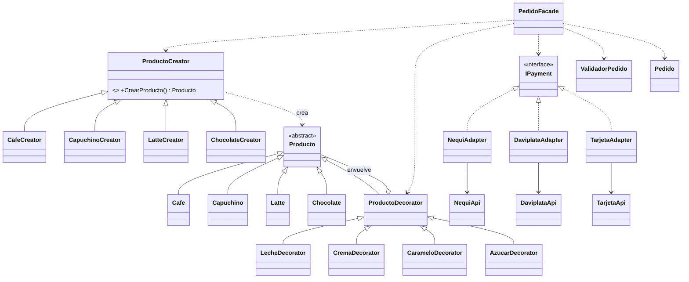

# Diseño: Sistema de pedidos para cafetería

Este documento describe el diseño. No contiene implementación: las firmas mostradas son los
contratos que el código debe respetar.

## Contexto técnico

- C# 12 / .NET 8, aplicación de consola.
- `ImplicitUsings` y `Nullable` habilitados: lo que puede faltar se declara con `?`
  (por ejemplo `Producto?`) y el compilador obliga a manejarlo.
- Precios con `decimal`.
- Pruebas con xUnit en un proyecto aparte.

## Estructura del proyecto

```text
CafeteriaPatterns/
├── Cafeteria.sln
├── openspec/
├── README.md
├── src/
│   └── Cafeteria/
│       ├── Cafeteria.csproj
│       ├── Program.cs
│       ├── Productos/         Producto, Cafe, Capuchino, Latte, Chocolate
│       ├── Creadores/         ProductoCreator, CafeCreator, CapuchinoCreator, LatteCreator, ChocolateCreator
│       ├── Complementos/      ProductoDecorator, LecheDecorator, CremaDecorator, CarameloDecorator, AzucarDecorator
│       ├── Pagos/             IPayment, ResultadoPago, NequiAdapter, DaviplataAdapter, TarjetaAdapter
│       │   └── Externos/      NequiApi, DaviplataApi, TarjetaApi (APIs simuladas)
│       └── Pedidos/           Pedido, EstadoPedido, ValidadorPedido, PedidoFacade
└── tests/
    └── Cafeteria.Tests/
```

## Clases e interfaces

### Productos (base del Factory Method y del Decorator)

```csharp
abstract class Producto
{
    abstract string Nombre { get; }
    abstract string Descripcion { get; }
    abstract decimal Precio { get; }   // acumulado; sin decorar equivale al precio base
}
```

`Cafe`, `Capuchino`, `Latte` y `Chocolate` heredan de `Producto` y solo fijan nombre, descripción
y precio base (3000, 4500, 5000 y 4000).

### Creadores (Factory Method)

```csharp
abstract class ProductoCreator
{
    abstract Producto CrearProducto();   // el factory method
}
```

`CafeCreator`, `CapuchinoCreator`, `LatteCreator` y `ChocolateCreator` sobrescriben
`CrearProducto()` y devuelven su producto.

### Complementos (Decorator)

```csharp
abstract class ProductoDecorator : Producto
{
    protected ProductoDecorator(Producto producto);   // guarda el producto envuelto
    // Nombre      -> el del producto envuelto
    // Descripcion -> la del envuelto + " + <complemento>"
    // Precio      -> el del envuelto + precio propio del complemento
}
```

`LecheDecorator` (1000), `CremaDecorator` (1500), `CarameloDecorator` (1200) y `AzucarDecorator`
(500) solo declaran su nombre y su precio.

### Pagos (Adapter)

```csharp
interface IPayment
{
    string Nombre { get; }
    ResultadoPago Pagar(decimal monto);
}

record ResultadoPago(bool Aprobado, string Mensaje);
```

Los **adaptados** simulan servicios externos con firmas incompatibles a propósito. Reciben en su
constructor los fondos disponibles, y aprueban si `monto <= fondos`:

| Adaptado | Firma | Retorno | Fondos por defecto |
|---|---|---|---|
| `NequiApi` | `EnviarPago(string celular, decimal valor)` | `bool` | 50000 |
| `DaviplataApi` | `Transferir(string cuenta, decimal monto)` | `string` (`"00"` aprobado) | 30000 |
| `TarjetaApi` | `Cobrar(string numero, decimal monto)` | `int` (0 denegado) | 100000 |

`NequiAdapter`, `DaviplataAdapter` y `TarjetaAdapter` implementan `IPayment`, envuelven su API y
traducen la respuesta a `ResultadoPago`.

### Pedidos

```csharp
enum EstadoPedido { Creado, Personalizado, PagoProcesado, Confirmado, Rechazado }

class Pedido
{
    Producto? Producto { get; }
    decimal Total { get; }
    EstadoPedido Estado { get; }
    string Mensaje { get; }
    // transiciones: Personalizar(producto), MarcarPagoProcesado(), Confirmar(), Rechazar(motivo)
    string ObtenerResumen();   // RF-14: estado, descripción, total y mensaje para mostrar
}

class ValidadorPedido
{
    IReadOnlyList<string> ValidarAntesDePago(Producto? producto, IPayment? medioPago);
    IReadOnlyList<string> ValidarPago(ResultadoPago resultado);
    // lista vacía = válido
}

class PedidoFacade
{
    PedidoFacade();                                            // medios de pago por defecto
    PedidoFacade(IReadOnlyDictionary<string, IPayment> medios);// para pruebas: medios inyectados
    Pedido RealizarPedido(string producto, IEnumerable<string> complementos, string medioPago);
}
```

## Relaciones



## Responsabilidades

| Clase | Responsabilidad | No debe hacer |
|---|---|---|
| `Producto` y concretos | Representar un producto y su precio | Saber cómo se crean o se pagan |
| `ProductoCreator` y concretos | Crear un producto | Calcular precios o validar |
| `ProductoDecorator` y concretos | Añadir un complemento y su costo | Crear productos ni conocer pagos |
| `IPayment` y adaptadores | Procesar un pago por una interfaz común | Conocer productos o pedidos |
| `ValidadorPedido` | Decidir si el pedido es válido | Coordinar el flujo |
| `Pedido` | Guardar estado, total y mensaje; proteger las transiciones; ofrecer el resumen a mostrar | Crear productos o pagar |
| `PedidoFacade` | Coordinar el proceso en orden | Calcular precio, validar o pagar por sí mismo |
| `Program` | Interactuar con el usuario e imprimir `Pedido.ObtenerResumen()` | Instanciar cualquier clase de patrón |

## Factory Method

- `ProductoCreator` declara `CrearProducto()`; cada subclase decide qué producto concreto crear.
- El Facade tiene un diccionario `nombre → ProductoCreator` y llama `CrearProducto()`. Solo ve
  `ProductoCreator` y `Producto`.
- Para agregar un producto: una clase de producto, una de creador y una entrada en el diccionario.
  No cambia ninguna otra clase.

## Decorator

- `ProductoDecorator` **es** un `Producto` y **tiene** un `Producto`. Por eso los decoradores se
  pueden anidar sin límite y el cliente los trata como un producto normal.
- El precio se calcula recursivamente: cada capa suma su valor al del producto envuelto.
- El Facade tiene un diccionario `nombre → función que envuelve un Producto` y aplica los
  complementos pedidos, en orden.
- Repetir un complemento (por ejemplo dos Leches) es válido: son dos capas. No requiere regla
  especial.

## Adapter

- El código principal solo conoce `IPayment`.
- Cada adaptador contiene una API adaptada con firma y resultado distintos (`bool`, `string`,
  `int`) y los traduce a `ResultadoPago`. Sin esa incompatibilidad el patrón no tendría sentido.
- El resultado depende solo de los fondos configurados, así que las pruebas son deterministas.

## Facade

`PedidoFacade.RealizarPedido` sigue este orden:

1. Buscar el `ProductoCreator` por nombre. Si no existe, el producto queda en `null`.
2. Crear el producto con `CrearProducto()` (Factory Method).
3. Aplicar cada complemento (Decorator). Si un complemento no existe, rechazar el pedido.
4. Marcar el pedido `PERSONALIZADO` y registrar el total (`Producto.Precio`).
5. Buscar el `IPayment` por nombre. Si no existe, queda en `null`.
6. **Validar antes del pago** (`ValidadorPedido`): hay producto y hay medio de pago.
7. Procesar el pago (`IPayment.Pagar`).
8. **Validar el resultado** del pago (`ValidadorPedido`). Si fue rechazado → `RECHAZADO`.
9. Pago aprobado: el pedido pasa a `PAGO_PROCESADO` y luego se confirma → `CONFIRMADO`.

Cualquier fallo en los pasos 3, 6 u 8 lleva el pedido a `RECHAZADO` con un mensaje y sin cobrar
(salvo el paso 8, que ya intentó el cobro).

## Flujo del pedido

```text
Program (menú numerado)
   │  producto, complementos, medio de pago (texto)
   ▼
PedidoFacade.RealizarPedido
   ├─► ProductoCreator.CrearProducto()     Factory Method   → Producto
   ├─► ProductoDecorator (uno por extra)   Decorator        → Producto decorado, Precio total
   ├─► ValidadorPedido.ValidarAntesDePago  Validación       → ¿hay producto y medio de pago?
   ├─► IPayment.Pagar(total)               Adapter          → ResultadoPago
   ├─► ValidadorPedido.ValidarPago         Validación       → ¿pago aprobado?
   └─► Pedido.Confirmar()                                    → CONFIRMADO / RECHAZADO
   ▼
Program muestra estado, descripción, total y mensaje
```

## Decisiones

| # | Decisión | Motivo |
|---|---|---|
| 1 | Jerarquía de creadores (no un `switch`) | Es el Factory Method real, no una Simple Factory |
| 2 | El Facade recibe nombres en texto | Así el cliente no conoce adaptadores ni decoradores, y el producto inválido (CA-03) es alcanzable |
| 3 | Búsqueda por diccionarios (`OrdinalIgnoreCase`) | Configuración simple. No se llama "fábrica" para no contar como segundo patrón creacional |
| 4 | Claves sin tilde (`Cafe`, `Azucar`) | `Program` usa un menú numerado, el usuario no escribe nombres |
| 5 | Rechazo con estado `RECHAZADO` + mensaje, sin excepciones | Son flujos esperados, no errores excepcionales |
| 6 | `PAGO_PROCESADO` solo si el pago es aprobado | Un pago rechazado va directo a `RECHAZADO` |
| 7 | Validación en dos momentos | RF-09 y RF-10 antes de cobrar; RF-11 después |
| 8 | `ValidadorPedido` separado del Facade | El Facade solo coordina |
| 9 | `Pedido` es el resultado; no hay `ResultadoPedido` | Menos clases; ya expone estado, total y mensaje |
| 10 | Pagos deterministas por fondos configurables | Pruebas estables; el segundo constructor del Facade permite inyectar un medio que rechaza |
| 11 | Complemento desconocido rechaza el pedido | Evita cobrar un total distinto al esperado |
| 12 | Nombres en español/inglés como en la especificación (`IPayment`, `ProductoCreator`) | Coherencia con lo que se evalúa |

## Riesgos

- **Segundo patrón creacional aparente.** Los diccionarios de nombre a creador, complemento o pago
  podrían confundirse con fábricas. Se mantienen como estructuras de datos privadas del Facade,
  sin clases ni nombres de fábrica.
- **Facade con demasiada lógica.** Si empieza a validar o calcular, deja de ser una fachada.
  Se controla con la tabla de responsabilidades y una revisión en `/opsx:verify`.
- **Proyecto demasiado grande.** Unas 30 clases pequeñas. Los productos, decoradores y adaptadores
  deben mantenerse casi idénticos entre sí, sin lógica extra.
